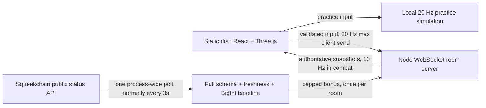

# Architecture and hosting limits

## Frontend

Vite, React and TypeScript compose an actual game screen. `src/scene.ts` builds original geometry with Three.js. Static scenery and immutable character parts are batched by material; pixel ratio is capped at 1.5 and the shadow map is 1024². Rendering caps at 30 Hz and skips hidden/unfocused pages. Reduced-motion idle scenes draw only after a state or size change; resize invalidates the drawing buffer cache. `src/audio.ts` synthesizes optional original effects after a user gesture.

`shared/game.ts` is the fixed 50 ms fight simulation used both for local practice and by the server. Live-room state is never simulated for authority by the browser. The client renders server snapshots and interpolates actor positions. There is no client score, reward, leaderboard or token economy. Practice can be modified in a visitor's own browser and creates no shared result.

Keyboard and touch directions map onto the overhead camera's world axes. Discrete attack, dodge and ability requests are latched until a simulation/network tick consumes them. Visibility loss clears inputs. Practice pauses locally; online pause explicitly hands control to an assistance bot. These bots remain labelled in the party HUD.

## Authoritative rooms

`server/index.ts` serves the built export and the `/rooms` WebSocket endpoint. `server/rooms.ts` owns room membership, crypto-random room/session identifiers, seat permissions and simulation ticks. The three-seat cap includes reserved reconnect seats. Open seats use bots; joining humans replace a bot of their chosen role when possible. Only the host can start or replay. Host ownership survives its 30-second reconnect grace, then transfers to a present player.

The server accepts finite bounded input directions and booleans with increasing safe-integer sequence numbers. Unknown input fields, client-supplied health/damage/score values and older sequences are rejected. Normalization, movement speed, world boundaries, boss collision, range, cooldowns, health, shield duration, death, shared energy, damage and outcomes are all server computed. Queued actions survive an input true/false burst between ticks without bypassing cooldowns.

Inputs expire after 300 ms; a 2-second stall activates bot coverage. Away/disconnected seats also use bots. Network reconnect uses an unpredictable in-memory token; it restores the same seat within 30 seconds. Tokens are not put in invite URLs or written to browser storage. Reloading the page loses that token. Empty rooms pause their simulation, receive no wheel bonus, and are removed after 60 seconds. Rooms have a two-hour maximum lifetime. Process restarts lose all rooms; there is no database or cross-process coordination.

Limits implemented:

| Boundary | Limit |
| --- | --- |
| Room size | 3 players; open slots are labelled bots |
| Process | 64 rooms |
| Message size | 2,048 bytes, compression disabled |
| Socket messages | 45-token burst, refill 30/s |
| Incoming connections per IP | 12-token burst, refill 1 per 5s |
| Concurrent connections per IP | 6 |
| IP bookkeeping | 4,096 entries; inactive entries cleaned after 60s |
| Outgoing socket backlog | Close above 131,072 buffered bytes |
| Heartbeat | Ping every 15s; terminate a missed next heartbeat |
| Idle unjoined socket | Close after 10s |

The server uses the direct socket IP, without trusting forwarded headers. A reverse proxy can therefore put visitors behind one IP and hit the six-connection limit. A public operator must choose a suitable proxy-aware deployment policy before exposing this small-room server at scale. It is a single-process community game server, not a distributed service or a load-tested public deployment. Exact origin allowlisting is supported through `ALLOWED_ORIGINS`; the empty local-development default accepts origins.

## Hardware telemetry

The only live source is `GET https://api.squeekchain.com/v1/status`. `server/schemas/status.json` is the published schemaVersion 1, JSON Schema draft 2020-12, downloaded 2026-11-03. Ajv validates every required field and union, date-time and UUID formats, and unsigned 64/96-bit decimal strings. Additive v1 fields are permitted according to the API compatibility guidance. Unsupported versions and malformed or unavailable data pause only the live bonus.

`WheelTracker` requires hardware provenance, online freshness, a non-faulted counter, and observation/receipt/generation times no older than 120 seconds or more than 5 seconds in the future. It checks their ordering, uses `BigInt` throughout counter arithmetic, and compares only the same installation and counter epoch. The first sample, an epoch/installation switch, or recovery from an error establishes a baseline. Repeated timestamps cannot award work. Counter/timestamp regression discards the baseline so an old head cannot cause previously awarded work to be counted again.

Four positive new work units yield one energy. Work is bounded as a BigInt before conversion; at most five energy can be credited per sample. A 10-token burst bucket refills at one energy per second, and the pool caps at 100. Excess is discarded instead of banked. Fractional work carries only within a valid uninterrupted stream. IDLE or zero-RPM samples reset that fraction, award nothing and show a resting hamster. No instruction encourages waking or interfering with it.

One poller serves all rooms. A monotonically increasing server batch number prevents replay per room. A new room or an empty room that reconnects skips its first batch; empty rooms never bank energy. Adding players cannot multiply a room's credit. Reconnecting the last player restarts the poller with a fresh baseline. Stop/start generations discard late in-flight responses and prevent duplicate polling loops.

Polling normally runs every 3 seconds with a 5-second request timeout and ETag revalidation. Cached 304 data is checked again for age. HTTP 429/503 honors numeric or HTTP-date `Retry-After`; failures use exponential backoff up to 120 seconds, without shortening a longer Retry-After value. Invalid, stale, faulted, replay/simulated/derived provenance or unavailable readings reset the baseline. Basic attacks, dodges, 45 initial energy and 1/s base recharge remain game rules, independent of telemetry.

The UI labels practice recharge simulated. It calls live hardware data telemetry, never settlement, token issuance or a prize. This implementation makes no blockchain reads or writes, deploys no contract and requests no wallet action.

## Hosting and delivery

`dist/index.html` and all runtime assets are included. Relative Vite asset paths and same-page state work on an IPFS/gateway subpath without rewrites. The assignment's publication pipeline is expected to publish that static export after delivery; this worker did not obtain or verify a public URL.

Static hosting cannot run the room server. No persistent public backend, TLS endpoint, domain, paid plan or uptime has been provisioned. The co-op dialog explicitly reports this. Local real multiplayer is validated; public Internet operation is not claimed. An owner can run `npm ci`, `npm run build`, `npm run server`, configure TLS/origins and set their public endpoint in `public/config.json`. No credential is required or bundled. Public hosting requires an operator; no service has been purchased.

Independent agent review was attempted but the runtime failed before a model turn. That required gate is open; see `independent-review.md`. The customer has not reviewed or submitted this work to Genesis, and no approval or payment verification is claimed.
